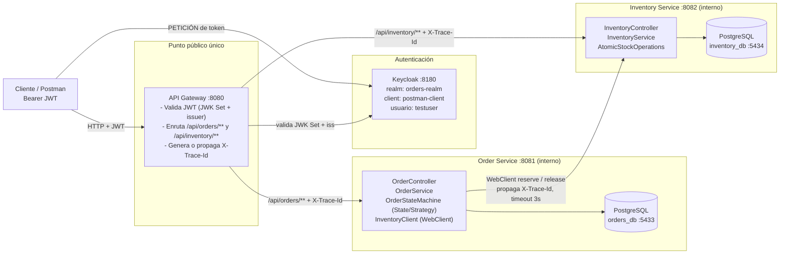
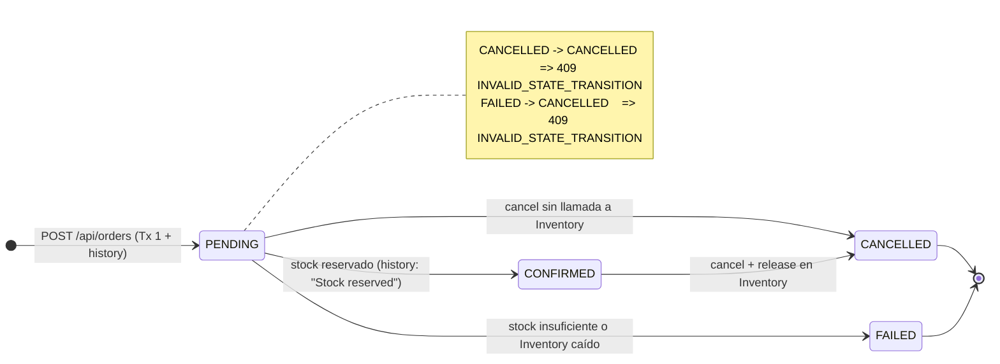
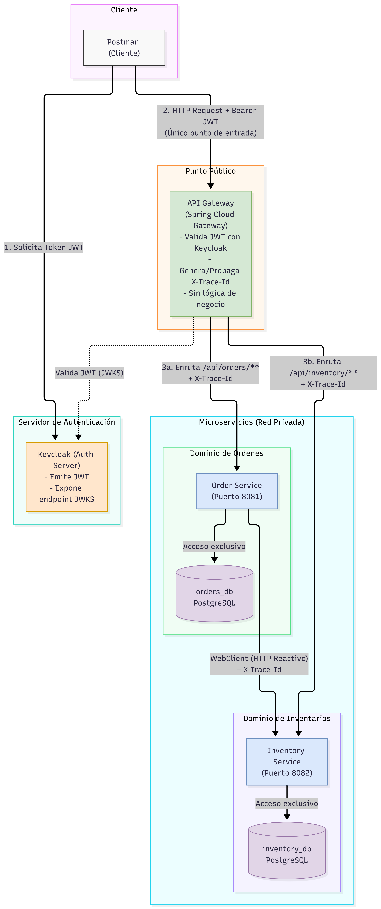
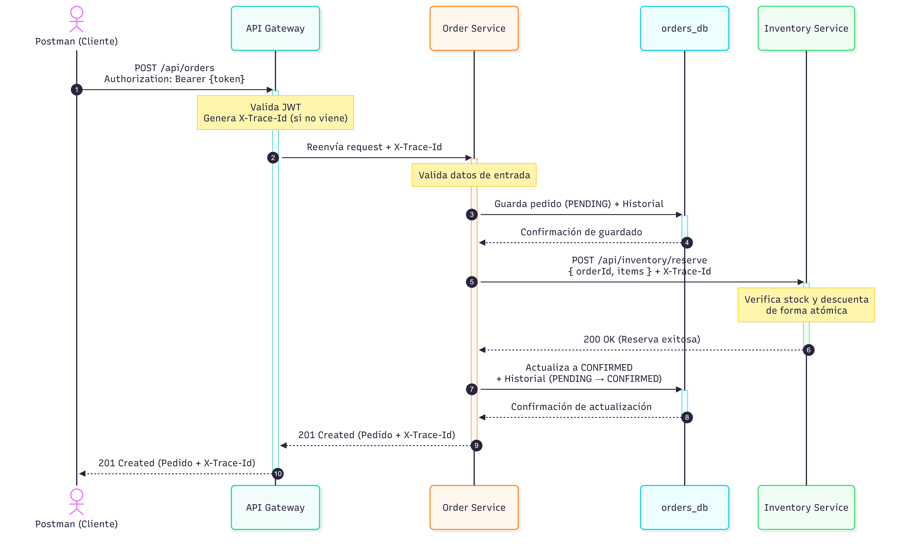
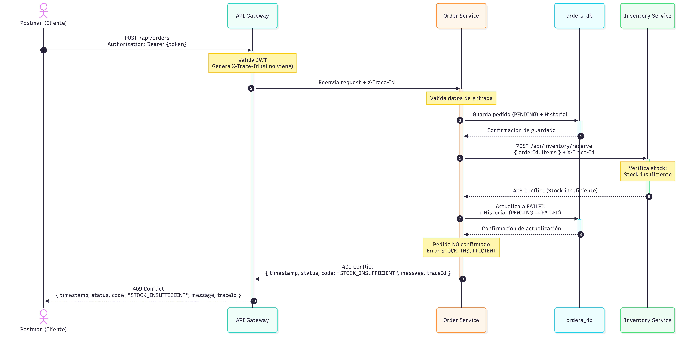
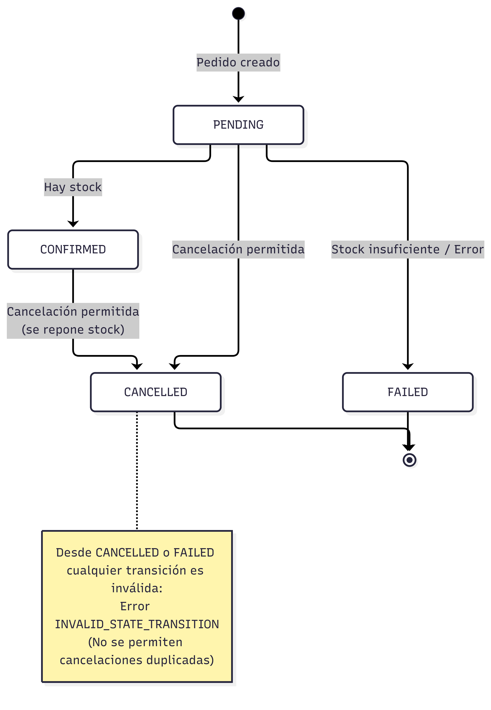
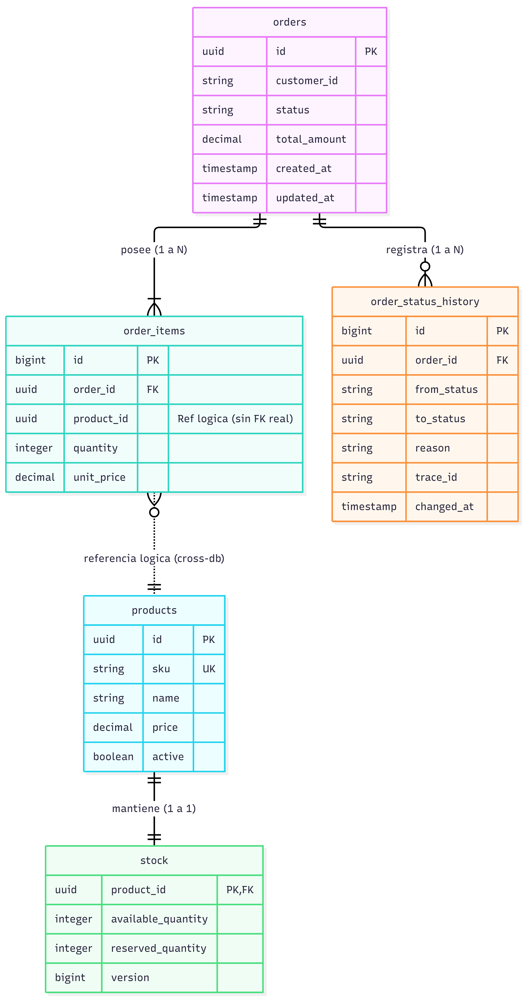
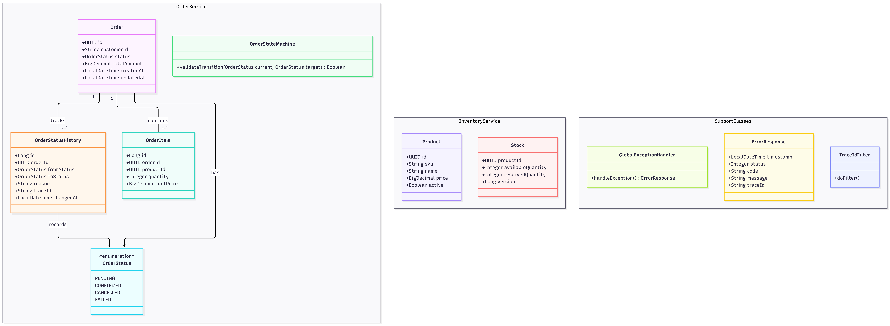
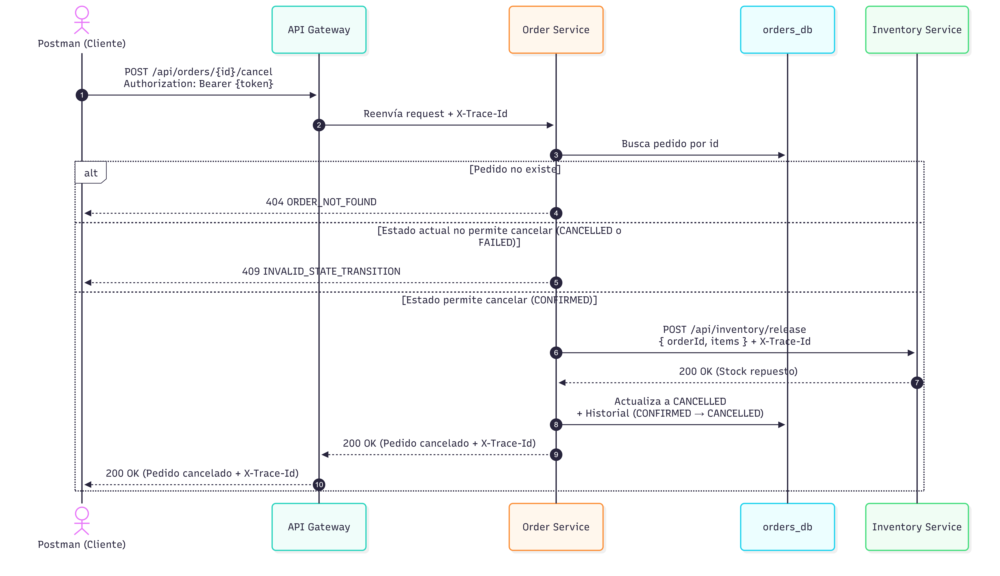
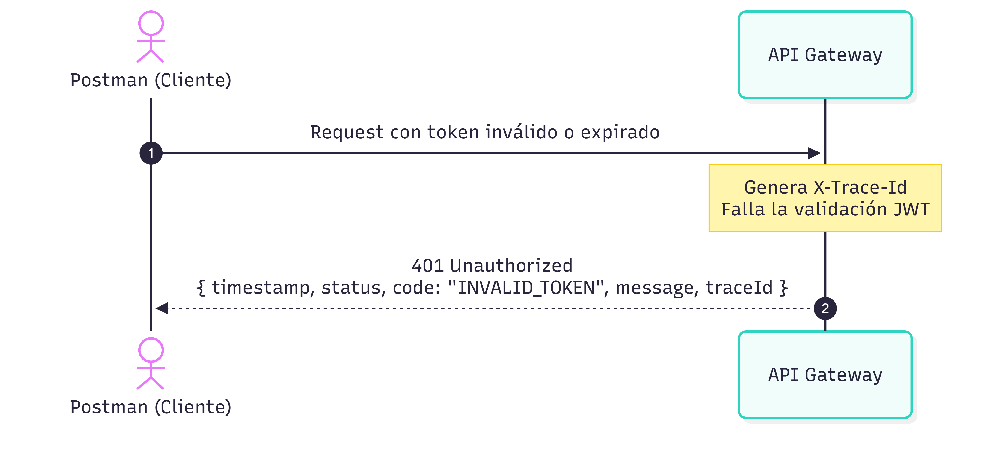

# Order Management Microservices

Reto técnico backend: sistema de gestión de pedidos con arquitectura de microservicios — **API Gateway** como único punto público, **Order Service**, **Inventory Service**, dos bases de datos PostgreSQL independientes y seguridad OAuth2/JWT con **Keycloak**.

- Todo el tráfico público pasa por el Gateway (los servicios no publican puertos al host).
- El Gateway no tiene lógica de negocio: valida JWT, enruta y genera/propaga `X-Trace-Id`.
- La reserva de stock es atómica (UPDATE condicional en SQL) e idempotente por `orderId`.

---

## Arquitectura

Fuente: [`docs/diagrams/01-arquitectura-componentes.mmd`](docs/diagrams/01-arquitectura-componentes.mmd)



---

## Tecnologías y versiones

| Tecnología | Versión | Uso |
|---|---|---|
| Java | 21 | Lenguaje (Dockerfiles con `eclipse-temurin:21`) |
| Maven | Wrapper incluido (`mvnw`) | Build por servicio, sin multi-módulo padre |
| Spring Boot | 4.1.1 | WebFlux (reactivo) en los tres servicios |
| Spring Cloud | 2025.1.3 | `spring-cloud-starter-gateway-server-webflux` en el Gateway |
| Spring Security | (dependencia de Boot) | OAuth2 Resource Server (JWT) |
| Keycloak | 26.0.1 | Proveedor de identidad (realm `orders-realm`) |
| PostgreSQL | 16 | Bases independientes `orders_db` (5433) y `inventory_db` (5434) |
| Spring Data R2DBC | (dependencia de Boot) | Acceso reactivo a PostgreSQL |
| springdoc-openapi | 3.1.1 | Docs OpenAPI en Order e Inventory |
| MapStruct | 1.6.3 | Mapeo DTO ↔ dominio (+ Lombok, binding 0.2.0) |
| Logback + AOP | (dependencia de Boot) | Logs con `X-Trace-Id` (MDC) y aspecto de logging por servicio |
| Tests | JUnit 5, Mockito, StepVerifier, WebTestClient | Tests unitarios y reactivos |

## Requisitos

- **Docker Desktop** (o cualquier motor compatible con `docker compose`).
- **Git** para clonar el repositorio.
- Opcional: **Java 21 + Maven** para correr los tests fuera de Docker, y **Postman** para importar la colección.

## Cómo ejecutar

```bash
git clone <url-del-repo>
cd order-management-microservices
docker compose up --build
```

Tiempos esperados (hardware típico):

| Etapa | Tiempo |
|---|---|
| Build de imágenes Maven (primera vez, sin caché) | 3–6 min por servicio |
| Descarga de imágenes base (Postgres, Keycloak, JRE) | variable |
| Healthchecks verdes (dbs + servicios) | ~1 min |
| Keycloak listo y realm importado | 20–60 s |

El Gateway arranca al final: depende de que todos los servicios estén `UP`. Pulsa `docker compose ps` hasta que todos muestren `healthy`. Verifica con:

```bash
curl http://localhost:8080/actuator/health   # {"status":"UP"}
```

Para correr los tests de cada servicio: `mvnw test` (ver sección [Tests](#tests)).

## URLs

| Componente | URL | Acceso |
|---|---|---|
| API Gateway | http://localhost:8080 | Único punto público de la API |
| Swagger UI (agregada por el Gateway) | http://localhost:8080/swagger-ui.html | Documentación de Order e Inventory |
| Health Gateway | http://localhost:8080/actuator/health | Público |
| Keycloak Admin | http://localhost:8180 | `admin` / `admin` |
| Keycloak (interno) | `http://keycloak:8080` | Dentro de la red Docker |
| Order Service | `http://order-service:8081` | Solo interno (sin puerto al host) |
| Inventory Service | `http://inventory-service:8082` | Solo interno (sin puerto al host) |
| PostgreSQL orders | localhost:5433 (`orders_db`) | `postgres` / `postgres` |
| PostgreSQL inventory | localhost:5434 (`inventory_db`) | `postgres` / `postgres` |

## Autenticación (Keycloak)

- Realm: **`orders-realm`** (importado automáticamente desde `keycloak/realm-export.json`).
- Client público: **`postman-client`** (OAuth2 password grant).
- Usuario de prueba: **`testuser` / `test1234`**.
- Vigencia del access token: **5 minutos** (300 s).

**Con curl:**

```bash
curl -X POST "http://localhost:8180/realms/orders-realm/protocol/openid-connect/token" \
  -d "grant_type=password" \
  -d "client_id=postman-client" \
  -d "username=testuser" \
  -d "password=test1234"
```

**Con PowerShell:**

```powershell
$resp = Invoke-RestMethod -Method Post `
  -Uri "http://localhost:8180/realms/orders-realm/protocol/openid-connect/token" `
  -Body @{ grant_type = "password"; client_id = "postman-client"; username = "testuser"; password = "test1234" }
$token = $resp.access_token
```

En ambos casos la respuesta es `application/x-www-form-urlencoded` con `access_token`, `token_type: Bearer`, `expires_in: 300`. Usa el token como header `Authorization: Bearer <access_token>` en cada llamada al Gateway. El Gateway valida firma (JWK Set de Keycloak), expiración y **issuer** (`iss` debe ser `http://localhost:8180/realms/orders-realm`).

**Con Postman:** importa la colección y corre la petición **00 Auth → Get Token**: guarda automáticamente el `access_token` en la variable `token` del entorno `Local`, y el resto de peticiones lo usan.

## Endpoints

Todos los endpoints requieren `Authorization: Bearer <token>` (excepto `POST .../token` de Keycloak y `GET /actuator/health`).

### Orders (a través del Gateway, puerto 8080)

| Método | Ruta | Descripción | Éxitos | Errores |
|---|---|---|---|---|
| POST | `/api/orders` | Crear pedido → PENDING → CONFIRMED/FAILED | 201 | 400 INVALID_REQUEST, 409 STOCK_INSUFFICIENT, 503 INVENTORY_UNAVAILABLE |
| GET | `/api/orders/{id}` | Consultar pedido con sus items | 200 | 400 INVALID_REQUEST, 404 ORDER_NOT_FOUND |
| GET | `/api/orders/{id}/history` | Historial de estados | 200 | 400, 404 |
| POST | `/api/orders/{id}/cancel` | Cancelar (solo desde PENDING/CONFIRMED) | 200 | 400, 404, 409 INVALID_STATE_TRANSITION, 503 INVENTORY_UNAVAILABLE |

**Crear pedido — request:**

```json
{
  "customerId": "customer-001",
  "items": [
    { "productId": "11111111-1111-4111-8b2d-111111111111", "quantity": 2, "unitPrice": 89.90 },
    { "productId": "22222222-2222-4222-8b2d-222222222222", "quantity": 1, "unitPrice": 34.50 }
  ]
}
```

**Crear pedido — response 201:**

```json
{
  "id": "0d6d5a4a-37ad-4e14-a089-64e08a8cd2b2",
  "customerId": "customer-001",
  "status": "CONFIRMED",
  "totalAmount": 214.30,
  "createdAt": "2026-10-22T12:00:00Z",
  "updatedAt": "2026-10-22T12:00:01Z",
  "items": [
    { "productId": "11111111-1111-4111-8b2d-111111111111", "quantity": 2, "unitPrice": 89.90 },
    { "productId": "22222222-2222-4222-8b2d-222222222222", "quantity": 1, "unitPrice": 34.50 }
  ]
}
```

**Historial — response 200 (GET /api/orders/{id}/history):**

```json
[
  { "fromStatus": null, "toStatus": "PENDING", "reason": "Order created", "traceId": "3f2c7c1e-...", "changedAt": "2026-10-22T12:00:00Z" },
  { "fromStatus": "PENDING", "toStatus": "CONFIRMED", "reason": "Stock reserved", "traceId": "3f2c7c1e-...", "changedAt": "2026-10-22T12:00:01Z" }
]
```

### Inventory (a través del Gateway, puerto 8080)

| Método | Ruta | Descripción | Éxitos | Errores |
|---|---|---|---|---|
| GET | `/api/inventory/products` | Listar productos con stock | 200 | — |
| GET | `/api/inventory/products/{id}` | Consultar un producto | 200 | 400 INVALID_REQUEST, 404 PRODUCT_NOT_FOUND |
| POST | `/api/inventory/reserve` | Reservar stock (atómico, idempotente por `orderId`) | 200 `RESERVED` / `ALREADY_RESERVED` | 400, 404, 409 STOCK_INSUFFICIENT |
| POST | `/api/inventory/release` | Liberar stock reservado por `orderId` | 200 `RELEASED` / `NOT_RESERVED` | 400, 404 |

**Reserva — request:**

```json
{
  "orderId": "f96c3ab4-3f6a-4b3e-a2a0-3dfb1d914a93",
  "items": [ { "productId": "11111111-1111-4111-8b2d-111111111111", "quantity": 2 } ]
}
```

**Reserva — response 200:**

```json
{
  "orderId": "f96c3ab4-3f6a-4b3e-a2a0-3dfb1d914a93",
  "items": [ { "productId": "11111111-1111-4111-8b2d-111111111111", "quantity": 2, "status": "RESERVED" } ]
}
```

## Productos semilla

Insertados de forma idempotente por el script `sql/schema.sql` de Inventory:

| Producto | SKU | UUID | Precio | Stock |
|---|---|---|---|---|
| Mechanical Keyboard | SKU-001 | `11111111-1111-4111-8b2d-111111111111` | 89.90 | 100 |
| Wireless Mouse | SKU-002 | `22222222-2222-4222-8b2d-222222222222` | 34.50 | 100 |
| 27" QHD Monitor | SKU-003 | `33333333-3333-4333-8b2d-333333333333` | 289.00 | 50 |
| USB-C Docking Station | SKU-004 | `44444444-4444-4444-8b2d-444444444444` | 159.00 | 75 |
| Noise Cancelling Headphones | SKU-005 | `55555555-5555-4555-8b2d-555555555555` | 199.99 | 25 |

## Estados del pedido y reglas de transición

`PENDING → CONFIRMED | FAILED | CANCELLED` · `CONFIRMED → CANCELLED`. Cualquier otra transición responde **409 INVALID_STATE_TRANSITION**. Cada cambio guarda una fila en `order_status_history` (`from`, `to`, `reason`, `trace_id`, `changed_at`).

Flujos:

- Crear: se persiste PENDING (Tx 1), luego se llama a Inventory **fuera de la transacción**. Reserva OK → CONFIRMED (Tx 2). Stock insuficiente → FAILED + respuesta 409 STOCK_INSUFFICIENT. Inventory caído/timeout → FAILED + respuesta 503 INVENTORY_UNAVAILABLE.
- Cancelar: solo desde **PENDING** o **CONFIRMED**. Desde CONFIRMED libera el stock en Inventory (*release*) antes de persistir el CANCELLED. Desde CANCELLED o FAILED → 409.

Fuente: [`docs/diagrams/04-maquina-estados.mmd`](docs/diagrams/04-maquina-estados.mmd)



## Manejo de errores

Formato único en los tres servicios (incluido el 401 del Gateway):

```json
{
  "timestamp": "2026-10-22T12:00:00Z",
  "status": 409,
  "code": "STOCK_INSUFFICIENT",
  "message": "Inventory could not reserve stock for the requested items",
  "traceId": "3f2c7c1e-103c-4e35-9f63-0b1ba2f99c8f"
}
```

| Código | HTTP | Cuándo ocurre |
|---|---|---|
| `INVALID_REQUEST` | 400 | Validación de campos, id no UUID, JSON malformado, producto inactivo |
| `INVALID_TOKEN` | 401 | Token ausente, inválido, expirado o con issuer incorrecto (Gateway) |
| `ORDER_NOT_FOUND` | 404 | Pedido inexistente |
| `PRODUCT_NOT_FOUND` | 404 | Producto inexistente |
| `STOCK_INSUFFICIENT` | 409 | Reserva falla por stock disponible insuficiente |
| `INVALID_STATE_TRANSITION` | 409 | Cancel desde CANCELLED/FAILED u otra transición no permitida |
| `INVENTORY_UNAVAILABLE` | 503 | Inventory caído, error 5xx o timeout (3 s) |
| `INTERNAL_ERROR` | 500 | Error inesperado |

## Trazabilidad (X-Trace-Id)

- El Gateway recibe `X-Trace-Id` o genera un UUID y lo añade a **todas las respuestas** (con o sin token) y a **todos los errores**.
- Se propaga a Order e Inventory; Order a su vez lo propaga a Inventory en las llamadas WebClient de `reserve`/`release`.
- Cada servicio lo guarda en el Reactor Context y lo expone en el **MDC** de Logback (patrón de logs incluye `X-Trace-Id`), y cada fila del historial de estados lo registra (`trace_id`).
- Los errores siempre llevan `traceId` en el body.

## Diagramas

Fuentes Mermaid y PNG equivalentes en `docs/diagrams/`:

| # | Diagrama | Mermaid | PNG |
|---|---|---|---|
| 01 | Arquitectura de componentes | `01-arquitectura-componentes.mmd` | `01-arquitectura-componentes.png` |
| 02 | Secuencia crear pedido | `02-secuencia-crear-pedido.mmd` | `02-secuencia-crear-pedido.png` |
| 03 | Secuencia sin stock / Inventory caído | `03-secuencia-sin-stock.mmd` | `03-secuencia-sin-stock.png` |
| 04 | Máquina de estados | `04-maquina-estados.mmd` | `04-maquina-estados.png` |
| 05 | Clases de dominio | `05-clases-dominio.mmd` | `05-clases-dominio.png` |
| 06 | Modelo ER | `06-modelo-er.mmd` | `06-modelo-er.png` |
| 07 | Secuencia cancelar pedido | `07-secuencia-cancelar-pedido.mmd` | `07-secuencia-cancelar-pedido.png` |
| 08 | Secuencia token inválido | `08-secuencia-token-invalido.mmd` | `08-secuencia-token-invalido.png` |

### Diagramas embebidos


*Arquitectura general: Gateway como único punto público, servicios internos, Keycloak y bases de datos independientes.*


*Flujo feliz de creación: pedido PENDING, reserva en Inventory y confirmación con trazas.*


*Fallos en la reserva: stock insuficiente (409) o Inventory caído/timeout (503), con pedido en FAILED.*


*Transiciones válidas entre PENDING, CONFIRMED, CANCELLED y FAILED; cualquier otra devuelve 409.*


*Clases de dominio de Order Service: pedido, items, historial de estados y máquina de estados.*


*Modelo entidad-relación de ambas bases: orders_db e inventory_db, sin FK entre bases.*


*Cancelación desde CONFIRMED: liberación de stock en Inventory antes de persistir CANCELLED.*


*Rechazo en el Gateway de un token ausente, expirado o con issuer incorrecto (401 con trace id).*

## Tests

```bash
# En cada servicio (requiere Java 21 + Maven wrapper)
cd order-service     && ./mvnw test        # (Windows: .\mvnw.cmd test)
cd inventory-service && ./mvnw test        # JUnit 5, Mockito, StepVerifier, WebTestClient
cd api-gateway       && ./mvnw test
```

Smoke test end-to-end contra el stack levantado con Docker (10 casos: token, crear, consultar, historial, cancelar, cancelar de nuevo 409, stock insuficiente 409, pedido inexistente 404, sin token 401, X-Trace-Id eco):

```powershell
.\scripts\smoke-test.ps1
```

## Colección de Postman

1. Importa `postman/Order-Management.postman_collection.json` y `postman/Local.postman_environment.json`.
2. Selecciona el entorno **Local**.
3. Ejecuta **00 Auth → Get Token** (guarda el `access_token` en `{{token}}`; recuerda que caduca a los 5 min, repítelo si da 401).
4. Corre las carpetas **01 Inventory**, **02 Orders**, **03 Security** y **04 Tracking**: incluyen casos de errores (409, 404, 401) y verificaciones del header `X-Trace-Id`.

## Decisiones de diseño

- **WebFlux (reactivo) en los tres servicios**: modelo no bloqueante para I/O intensivo (BD + llamadas HTTP entre servicios); contexto Reactor para propagar el trace id.
- **Spring Data R2DBC**: acceso reactivo a PostgreSQL sin bloquear el event loop; esquema inicial con `sql/schema.sql` (nunca `ddl-auto`).
- **Reserva atómica con UPDATE condicional**: `UPDATE stock ... WHERE available_quantity >= :qty` — un solo statement, sin leer-y-escribir; la concurrencia se resuelve con row locking y sin cumplir la condición no se actualiza ninguna fila.
- **Idempotencia por `orderId`**: las reservas se registran en `stock_reservations` con PK `(order_id, product_id)`; repetir `reserve` para el mismo pedido responde `ALREADY_RESERVED` y repetir `release` `NOT_RESERVED`.
- **Llamada HTTP fuera de la transacción**: la reserva a Inventory no es transaccional ni compensable, así que se ejecuta fuera de la Tx; CONFIRMED/FAILED/CANCELLED se persisten en transacciones propias para no deshacer las filas ya confirmadas.
- **State/Strategy para transiciones de estado**: `OrderStateMachineImpl` con mapa de transiciones válidas valida cada cambio y lanza 409 `INVALID_STATE_TRANSITION`; el servicio queda libre de reglas dispersas.
- **Gateway sin lógica de negocio**: solo valida JWT, enruta y genera/propaga `X-Trace-Id`; no compone respuestas entre servicios.
- **Docs públicas**: Order e Inventory exponen `/v3/api-docs` y el Gateway los agrega en `/docs/{service}/v3/api-docs/**` con una única Swagger UI en `http://localhost:8080/swagger-ui.html`.
- **Validación de issuer**: además de firma y expiración, el Gateway exige `iss == http://localhost:8180/realms/orders-realm` (`IssuerTokenValidator`).

## Limitaciones conocidas y mejoras futuras

- **Sin Saga/Outbox**: si el proceso muere tras reservar stock pero antes de persistir CONFIRMED, la reserva queda sin liberar (se prefirió simplicidad ante el alcance del reto; Saga/Outbox/Event Sourcing estaban fuera de alcance).
- **Sin retry/circuit breaker** en las llamadas Order ↔ Inventory: un timeout de 3 s mapea a 503 sin reintentos.
- **Secretos por defecto** (Postgres `postgres`, Keycloak `admin`, credenciales de demo `testuser`): pensados para el entorno local; usar variables de entorno/secrets reales en producción.
- **HTTP sin TLS** entre Gateway/Keycloak/servicios: desplegar HTTPS y mTLS internos.
- **Sin rate limiting ni quotas** en el Gateway.
- **`unitPrice` lo envía el cliente** al crear el pedido: en producción debería calcularse server-side desde el catálogo.
- **Sin paginación** en el listado de productos.
- **Trace id no interoperable** con estándares W3C (`traceparent`); migrar a OpenTelemetry sería el siguiente paso.
